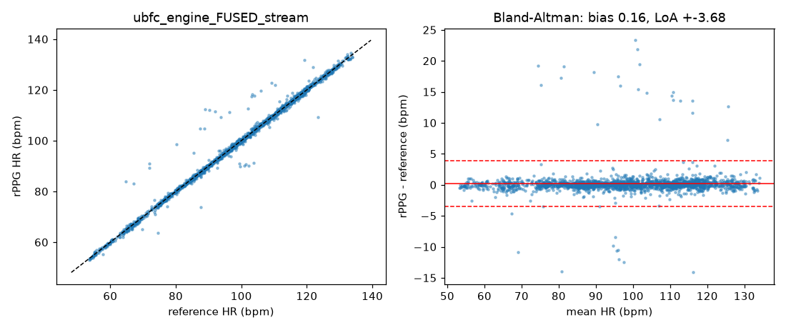
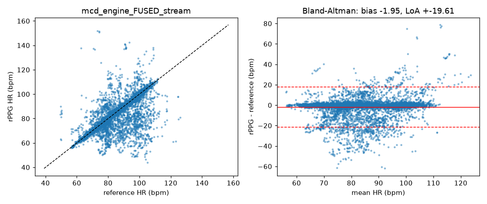
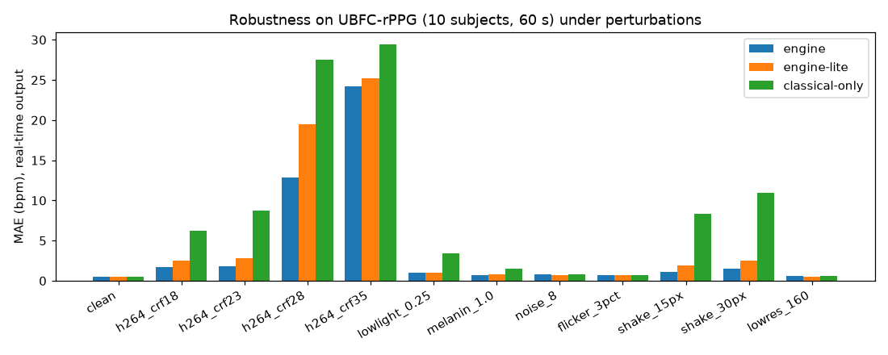
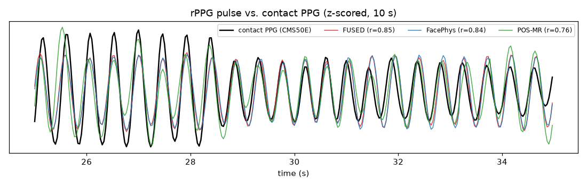

# Benchmark

All numbers were produced by `apps/rppg_bench` (C++ engine, exactly the code that ships) on the
subsets listed below. Reference heart rate is computed from the dataset's **contact PPG of a medical
pulse oximeter** with the same spectral estimator as the predictions (smoothness-priors detrend,
Butterworth band-pass 40–200 bpm, Hann periodogram peak). Raw per-window CSVs: `docs/results/raw/`;
generated tables: `docs/results/*.csv`, `docs/results/tables.md`.

## Datasets (test subsets, nothing was trained on them)

| Dataset | Subset used | Camera / conditions | Reference device |
|---|---|---|---|
| [UBFC-rPPG](https://sites.google.com/view/ybenezeth/ubfcrppg) DATASET_2 | 38 subjects (of 42; all fully downloaded ones with ground truth) | Logitech C920 webcam, 640×480 @ 30 fps, uncompressed, indoor, subjects playing a math game | CMS50E finger pulse oximeter |
| [MCD-rPPG](https://huggingface.co/datasets/kyegorov/mcd_rppg) (ACM MM 2025) | 44 videos: 7–8 subjects × {frontal FullHD camcorder, phone (Iriun, right side), USB webcam (left side)} × {rest, after exercise}, 3 min each | MPEG-4 compressed, de-identified (blurred) faces, side cameras at ~45–80° yaw | 100 Hz contact PPG, frame-synchronised |

The neural models (FacePhys, ME-rPPG) were trained by their authors on RLAP only, so both datasets
are **cross-dataset** tests. No engine parameter was fitted to UBFC; the fusion prior / pose prior
were chosen on MCD and kept only because they also did not hurt UBFC.

## Protocols

* **real-time** — the causal output an app displays: every 1 s, HR of the trailing 10 s window with
  HMM tracking (`Engine::replay_streaming`), compared with the reference HR of the same 10 s.
* **10 s windows** — offline analysis, sliding 10 s windows (1 s hop), Viterbi-tracked.
* **whole video** — one HR per video from the periodogram of the full-length pulse
  (rPPG-Toolbox protocol, comparable to its published tables).

Metrics: MAE, RMSE, MAPE (%), Pearson r, acc5 = % of estimates within ±5 bpm.

## 1. Engine presets

| Dataset | Preset | Real-time MAE | acc5 | 10 s windows MAE | Whole-video MAE |
|---|---|---|---|---|---|
| UBFC-rPPG | **engine (default)** | **0.62** | 98.5 % | **0.57** | 1.11 |
| UBFC-rPPG | engine-lite (FacePhys + POS) | 0.61 | 98.4 % | 0.56 | 0.99 |
| UBFC-rPPG | classical-only (no ONNX nets) | 0.62 | 98.6 % | 0.62 | 1.05 |
| MCD frontal camera | **engine** | **2.04** | — | **1.78** | 1.23 |
| MCD phone, right side | engine | 5.55 | — | 4.90 | 1.95 |
| MCD USB, left side (~70° yaw) | engine | 7.81 | — | 8.41 | 5.85 |
| MCD all 44 videos | **engine** | **4.99** | 76.9 % | **4.93** | 2.95 |
| MCD all | engine-lite | 6.34 | 72.0 % | 5.99 | 4.17 |
| MCD all | classical-only | 12.96 | 52.0 % | 12.85 | 11.06 |

## 2. Every method, same front-end (10 s windows, untracked per-window peak; whole-video)

UBFC-rPPG (38 subjects):

| Method | MAE | RMSE | MAPE | r | acc5 | whole MAE | whole r |
|---|---|---|---|---|---|---|---|
| **FUSED** | **0.58** | 1.78 | 0.61 | 1.00 | 98.6 | 0.95 | 1.00 |
| FacePhys | 0.62 | 2.03 | 0.67 | 0.99 | 98.6 | 0.98 | 0.98 |
| POS-MR (multi-ROI) | 0.63 | 1.96 | 0.67 | 0.99 | 98.7 | **0.46** | 1.00 |
| PRISM | 0.66 | 1.95 | 0.71 | 0.99 | 98.8 | 0.71 | 0.99 |
| POS | 0.67 | 2.19 | 0.71 | 0.99 | 98.7 | 0.94 | 0.99 |
| ME-rPPG | 0.74 | 1.88 | 0.80 | 0.99 | 98.5 | 0.72 | 0.99 |
| CHROM | 0.79 | 3.16 | 0.84 | 0.99 | 98.2 | 1.82 | 0.97 |
| OMIT | 1.11 | 4.76 | 1.19 | 0.97 | 97.6 | 1.27 | 0.98 |
| LGI | 1.11 | 4.77 | 1.19 | 0.97 | 97.5 | 1.27 | 0.98 |
| 2SR | 1.78 | 7.38 | 1.86 | 0.93 | 96.0 | 2.28 | 0.94 |
| PBV | 1.84 | 6.92 | 1.86 | 0.93 | 95.5 | 1.91 | 0.97 |
| GREEN | 3.27 | 11.53 | 3.16 | 0.83 | 92.6 | 1.21 | 0.99 |
| ICA | 4.92 | 13.78 | 4.96 | 0.78 | 82.9 | 3.24 | 0.91 |
| PCA | 5.81 | 15.02 | 5.80 | 0.75 | 79.4 | 2.17 | 0.98 |

Published references on UBFC-rPPG (whole video unless noted): rPPG-Toolbox POS 4.08, CHROM 4.06,
LGI 15.80, PBV 15.90, ICA 16.00, GREEN 19.73; PRISM 0.66 (10 s windows, NeurIPS 2025);
FacePhys 0.43 / ME-rPPG 0.47 (RLAP → UBFC, authors' protocol); PhysNet 0.98, TS-CAN 1.30
(PURE → UBFC, toolbox). On the whole-video protocol the same classical algorithms are 2–16× more
accurate here than in the toolbox tables (POS 0.94 vs 4.08, LGI 1.27 vs 15.80, GREEN 1.21 vs 19.73)
because of the face-mesh ROIs, adaptive skin model and timestamp-exact processing.

MCD-rPPG (44 videos): FUSED 6.27, ME-rPPG 6.55, FacePhys 8.22, POS 13.1, OMIT 14.0, LGI 14.1,
PBV 14.5, POS-MR 14.5, 2SR 14.6, GREEN 16.0, PRISM 16.7, CHROM 18.2, ICA 20.8, PCA 20.9
(untracked per-window peaks; tracking brings the engine to 4.93). Whole video: ME-rPPG 2.18,
FUSED 3.16, FacePhys 3.92. Colour methods are fine on the frontal camera but collapse on the
compressed side views; this is why the fusion prior is pose-aware.

## 3. Ablations (engine, MAE in bpm)

| Variant | UBFC 10 s | UBFC real-time | MCD 10 s | MCD real-time |
|---|---|---|---|---|
| **default** | 0.57 | 0.62 | 4.93 | 4.99 |
| no HMM tracking (per-window peak) | 0.54 | — | 6.43 | — |
| without pose-aware prior | 0.57 | — | 5.72 | — |
| equal priors (colour = neural) | 0.56 | — | 5.00 | — |
| motion-spectrum attenuation ON | 0.61 | 0.65 | 5.07 | 5.37 |
| window 8 s / 15 s / 30 s | 0.64 / 0.65 / 0.56 | — | 5.24 / 4.28 / 3.30 | — |

Longer windows trade latency for accuracy (30 s: MCD 3.30 bpm); 10 s is the default for
responsiveness. Tracking matters most on hard video (MCD +30 % error without it).

## 4. Signal-quality index and artefact rejection (real-time output)

| SQI ≥ | MCD coverage | MCD MAE | MCD acc5 | UBFC coverage | UBFC MAE |
|---|---|---|---|---|---|
| 0 | 100 % | 4.99 | 76.9 % | 100 % | 0.62 |
| 0.3 | 77.9 % | 3.29 | 85.6 % | 99.9 % | 0.61 |
| 0.5 | 61.3 % | 2.24 | 91.2 % | 98.9 % | 0.56 |
| 0.7 | 43.8 % | 1.36 | 96.2 % | 96.2 % | 0.50 |

The SQI is monotone with error: on clean video it keeps nearly everything, on hard video it rejects
the unreliable windows (recommended display threshold 0.5).

## 5. Robustness: real UBFC videos under controlled perturbations

10 subjects, first 60 s, real-time MAE (`tools/bench/run_robustness.ps1`, `apps/rppg_bench/augment.hpp`).

| Condition | engine | engine-lite | classical-only | best single candidate (10 s) |
|---|---|---|---|---|
| clean | **0.54** | 0.51 | 0.55 | POS 0.64 |
| H.264 CRF 18 (714 kbps) | **1.68** | 2.55 | 6.27 | ME-rPPG 1.47 |
| H.264 CRF 23 (179 kbps) | **1.84** | 2.85 | 8.71 | FacePhys 1.62 |
| H.264 CRF 28 (54 kbps) | 12.85 | 19.44 | 27.51 | ME-rPPG 11.96 |
| H.264 CRF 35 (23 kbps) | 24.16 | 25.17 | 29.47 | FacePhys 22.76 |
| low light ×0.25 + shot noise | **0.98** | 1.04 | 3.43 | FacePhys 1.09 |
| darker-skin proxy (melanin attenuation) | **0.73** | 0.78 | 1.51 | FacePhys 0.97 |
| sensor noise σ = 8 | 0.78 | 0.69 | 0.78 | FacePhys 0.86 |
| in-band illumination flicker 3 % | **0.73** | 0.71 | 0.69 | POS-MR 0.80 |
| camera shake 15 px | **1.12** | 1.91 | 8.37 | FacePhys 1.20 |
| camera shake 30 px | **1.55** | 2.56 | 10.97 | FacePhys 1.43 |
| low resolution (160 px wide) | **0.55** | 0.53 | 0.57 | POS 0.59 |

* Lighting, noise, resolution and skin reflectance are handled by all presets; the neural candidates
  dominate in low light and on the darker-skin proxy, the colour candidates under flicker (ME-rPPG
  alone 6.98 bpm with flicker) — the fusion picks the right one in each case.
* Compression is the main camera-dependent failure: up to ~180 kbps (CRF 23) the engine stays below
  2 bpm, while colour methods degrade to 6–9 bpm; at ≤ 54 kbps no method recovers the pulse.
* The darker-skin and low-light rows are *simulations* (channel-wise attenuation with photon noise)
  — UBFC and MCD contain mostly light skin types; a real Fitzpatrick V–VI evaluation is still needed.

## 6. Pulse-rate variability vs. contact PPG (whole recording, same beat detector)

| Dataset | metric | rPPG mean | reference mean | MAE | r |
|---|---|---|---|---|---|
| UBFC | mean HR (bpm) | 98.1 | 97.9 | 0.34 | 1.00 |
| UBFC | SDNN (ms) | 47.7 | 51.8 | 5.2 | 0.96 |
| UBFC | RMSSD (ms) | 35.0 | 47.9 | 14.7 | 0.80 |
| UBFC | pNN50 (%) | 14.4 | 24.1 | 11.5 | 0.78 |
| MCD | mean HR (bpm) | 81.5 | 81.8 | 1.1 | 0.99 |
| MCD | SDNN (ms) | 83.6 | 53.9 | 29.8 | 0.46 |
| MCD | RMSSD (ms) | 89.0 | 43.3 | 45.7 | 0.37 |

HRV is usable on good webcam video (SDNN within ~5 ms, r = 0.96) but not on compressed side-view
video, where beat-timing noise inflates SDNN / RMSSD. Respiration is computed but not validated here
(no synchronised respiration reference in the subsets).

## 7. Speed (Intel i7-12700, one core, 640×480, includes video decoding and 1 Hz analysis)

| Preset | fps | ms / frame |
|---|---|---|
| default (face mesh + FacePhys + ME-rPPG) | 52.6 | 19.0 |
| lite (face mesh + FacePhys) | 68.1 | 14.7 |
| classical (face mesh only) | 87.2 | 11.5 |

ONNX Runtime with 2 intra-op threads was slower (45.5 fps) — the tensors are tiny; use 1 thread per
model and, if needed, run models on separate threads.

## Reproduce

See the README ("Benchmark reproduction"). `rppg_bench capture` caches the per-frame traces once;
every table above is then regenerated from the caches in minutes.

## Limitations

* Subsets: 38 UBFC subjects, 44 MCD videos (7–8 subjects) and 10 subjects × 12 perturbations.
* MCD faces appear blurred (de-identification), which favours colour averaging; side views have
  reduced skin visibility.
* No real dark-skin dataset and no large-motion dataset (PURE, MMPD, UBFC-Phys need agreements;
  the LGI-PPGI server was offline); motion and skin-tone are covered by simulations only.
